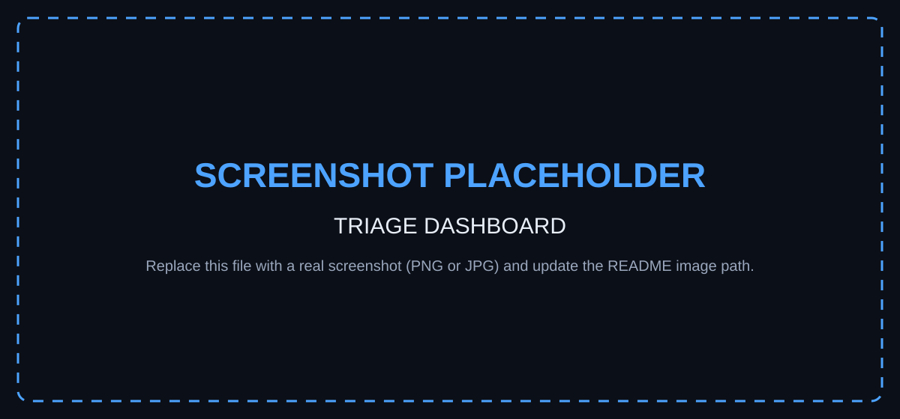
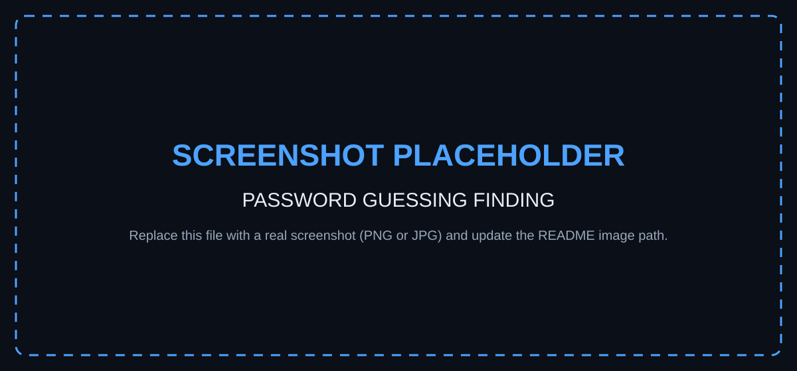
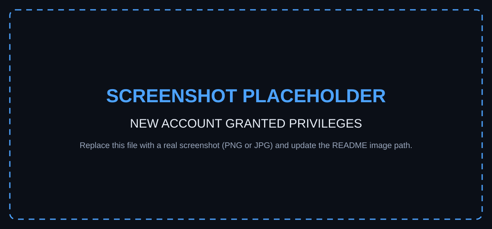
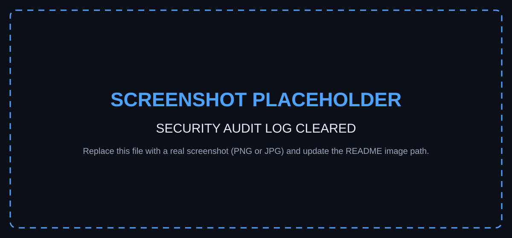
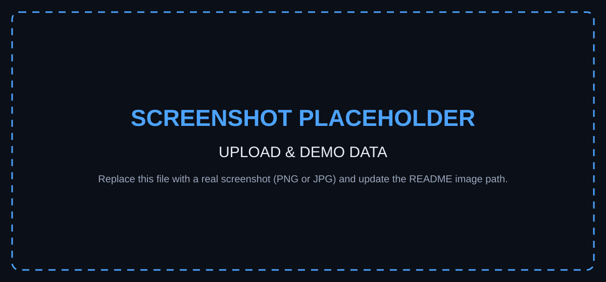

<div align="center">

# 🛡️ Windows Security Event Log Triage Tool

**An educational SOC triage tool that turns exported Windows Security Event logs (CSV) into clear, explainable findings — 100% inside your browser.**

</div>

<p align="center">
  
  
  
  
  
  
  
</p>

---

## 📌 Project Overview

This is a **browser-based SOC triage tool** for Windows Security Event Log CSV exports. A student (or analyst) exports security events, uploads the CSV, and the tool parses it **locally**, recognises important Event IDs, **correlates related events**, and produces a clear, explainable SOC-style report.

> **"A detection is a reason to investigate, not proof that an attacker is present."**

This is **not** an "AI hacker detector". It uses transparent, rule-based logic to highlight activity that *deserves investigation* — and it always explains both the suspicious and the benign explanations.

---

## ✨ Features

- 🔒 **Fully local analysis** — the uploaded CSV never leaves your browser (no server, no APIs, no tracking).
- 📄 **Tolerant CSV parsing** — handles column-name variations (`Event ID`, `EventID`, `event_id`) and quoted/multi-line `Message` fields.
- 🆔 **Recognises 10 security-relevant Event IDs** (4624, 4625, 4688, 4720, 4726, 4728, 4732, 1102, 4104, 7045).
- 🔗 **Correlation rules** — failed logons → password guessing, account-created → privilege-added, audit-log-cleared, and more.
- 📊 **SOC-style dashboard** — event counts, top accounts, most common Event IDs, a timeline, and a findings list.
- 🧮 **Explainable scoring** — every finding shows exactly which factors contributed (no fake "93% malicious" probabilities).
- 🎚️ **Configurable thresholds** — failed-login threshold and optional time window, adjustable live.
- 🔍 **Filters & search** — by Event ID, account, severity, source IP, and event type.
- ♿ **Accessible & secure** — semantic HTML, keyboard support, and full HTML-escaping of untrusted CSV content.

---

## 🚀 Quick Start

**No installs, no build step, no server required.**

1. Download or clone this repository.
2. Keep `index.html`, `styles.css`, `script.js`, and the `samples/` folder together.
3. Double-click **`index.html`** to open it in any modern browser (Chrome, Edge, Firefox, Safari).
4. Upload a CSV — or click a **Demo Data** button to load a fictional sample instantly.

> The **Demo Data** buttons load embedded copies of the sample files so they work even when the page is opened directly from disk.

---

## 🎯 Why This Project?

The educational goal is to teach **how SOC analysts actually think**:

1. **Identify the event.**
2. **Understand what happened.**
3. **Identify the affected user or system.**
4. **Determine whether the activity is expected.**
5. **Look for related events.**
6. **Correlate authentication and privilege activity.**
7. **Gather additional evidence.**
8. **Decide whether escalation is required.**

> **"One security event rarely tells the entire story. Analysts build context by correlating multiple events."**

---

## 🖼️ Screenshots

> **📸 Screenshot placeholders** — the images below are temporary grey boxes. Replace each `screenshots/*.svg` with a real `.png`/`.jpg`, then update the path in this README (or just save your image with the same filename and change the extension).

<!-- ══════════════════════════════════════════════════════════════════════
     SCREENSHOT SLOT 1 — Dashboard
     Replace the  below with:  screenshots/dashboard.png
     ══════════════════════════════════════════════════════════════════════ -->
### 1. Triage Dashboard


<!-- ══════════════════════════════════════════════════════════════════════
     SCREENSHOT SLOT 2 — Password Guessing
     Replace the  below with:  screenshots/password-guessing.png
     ══════════════════════════════════════════════════════════════════════ -->
### 2. Possible Password Guessing Followed by Success


<!-- ══════════════════════════════════════════════════════════════════════
     SCREENSHOT SLOT 3 — New Account Granted Privileges
     Replace the  below with:  screenshots/privilege-escalation.png
     ══════════════════════════════════════════════════════════════════════ -->
### 3. New Account Granted Privileges


<!-- ══════════════════════════════════════════════════════════════════════
     SCREENSHOT SLOT 4 — Security Audit Log Cleared
     Replace the  below with:  screenshots/log-cleared.png
     ══════════════════════════════════════════════════════════════════════ -->
### 4. Security Audit Log Cleared


<!-- ══════════════════════════════════════════════════════════════════════
     SCREENSHOT SLOT 5 — Upload & Demo Data
     Replace the  below with:  screenshots/upload-and-demo.png
     ══════════════════════════════════════════════════════════════════════ -->
### 5. Upload & Demo Data


---

## 📊 Supported Event IDs

| Event ID | Name | Default severity |
| :---: | --- | :---: |
| 4624 | Successful logon | Informational |
| 4625 | Failed logon | Informational |
| 4688 | Process created | Informational |
| 4720 | User account created | Medium |
| 4726 | User account deleted | Low |
| 4728 | Added to global security group | Medium |
| 4732 | Added to local security group | Medium |
| 1102 | Security audit log cleared | High |
| 4104 | PowerShell script block logging | Informational |
| 7045 | Service installed | Medium |

> Severity reflects **investigative priority**, not a certainty of compromise.

---

## 🔎 Detection & Correlation Rules

Each finding includes: **alert name, severity, event IDs, account, time range, source IP/workstation (if available), observed activity, why it matters, a benign explanation, suggested investigation, and an investigation score.**

| Rule | Name | Trigger | Severity |
| :---: | --- | --- | :---: |
| 1 | Repeated Failed Logons | `4625` grouped by account ≥ threshold | Medium |
| 2 | Password Guessing Followed by Success | repeated `4625` then a `4624` for the same account | High |
| 3 | New Account Granted Privileges | `4720` followed by `4728`/`4732` for the same account | Medium / High (privileged group) |
| 4 | Security Audit Log Cleared | `1102` appears | High |
| 5 | Administrative / Privilege Activity | account/group/service/log-clearing summarised together | Summary |

### Optional
- **Obfuscated PowerShell** — `4104` script blocks that look encoded/heavily obfuscated are flagged (Low). PowerShell itself is **not** treated as suspicious.

---

## 🎚️ Explainable Scoring

Instead of a fake probability (e.g. *"93% malicious"*), findings carry an **investigation score** built from transparent factors:

- `+10` repeated failed logons
- `+20` successful login following failures
- `+25` privileged group membership change
- `+30` security log cleared
- `+10` account created / service installed

The exact factors are displayed on every finding. **This is an educational prioritisation mechanism, not a mathematical probability of compromise.**

---

## ⚙️ Configurable Settings

| Setting | Default |
| --- | :---: |
| Failed login threshold | 5 |
| Failed login time window | 10 minutes (optional) |

> Security thresholds vary by environment. These are educational defaults, not universal SOC detection rules. The time window is best-effort: if timestamps can't be parsed reliably, the tool degrades gracefully rather than forcing an unreliable calculation.

---

## 📁 Repository Structure

```
windows-security-event-triage/
│
├── index.html                  ← page structure & educational content
├── styles.css                  ← dark, accessible theme
├── script.js                   ← CSV parsing, detection, correlation, rendering
├── README.md                   ← this file
├── LICENSE                     ← MIT license (update the copyright name)
├── .gitignore
│
├── samples/                    ← fictional demo datasets (CSV)
│   ├── normal-windows-events.csv
│   ├── password-guessing.csv
│   ├── account-persistence.csv
│   └── suspicious-admin-activity.csv
│
└── screenshots/                ← screenshot placeholders (replace with PNG/JPG)
    ├── dashboard.svg
    ├── password-guessing.svg
    ├── privilege-escalation.svg
    ├── log-cleared.svg
    └── upload-and-demo.svg
```

---

## 📚 How to Export Windows Event Data

**Important:** Event Viewer's default *"Save All Events As…" → CSV* only includes a few columns and **omits the `Message` text**. Without `Message`, the tool can't extract account names, source IPs, or group names.

For the richest results, export with **PowerShell**:

```powershell
Get-WinEvent -FilterHashtable @{ LogName = 'Security' } -MaxEvents 1000 |
  Select-Object TimeCreated, Id, LevelDisplayName, MachineName, Message |
  Export-Csv -Path "$env:USERPROFILE\Desktop\security-events.csv" -NoTypeInformation
```

- Replace `Security` with `Microsoft-Windows-PowerShell/Operational` to analyse Event ID 4104.
- The tool is tolerant of column-name variations and column order.

### Simpler Event Viewer-only option
Event Viewer → Windows Logs → Security → **Action → Save All Events As → CSV**. This works, but because it omits `Message`, the tool will show fewer account/IP details and will warn you.

---

## 🧪 Sample Datasets

All samples are **fictional** and use private/reserved IP ranges. No real people or organisations are involved.

| File | Scenario | Expected result |
| --- | --- | --- |
| `samples/normal-windows-events.csv` | Ordinary logons, process creation, routine admin | Few / no high-priority alerts |
| `samples/password-guessing.csv` | 8 failed logons then a success (same user, same IP) | "Possible Password Guessing Followed by Success" |
| `samples/account-persistence.csv` | Account created then added to Administrators | "New Account Granted Privileges" |
| `samples/suspicious-admin-activity.csv` | Failures + success + account creation + privilege change + log clearing | Several correlated findings |

### 🎬 Recommended demo sequence
1. Load **Normal** → mostly informational/low activity.
2. Load **Password Guessing** → repeated-failures finding.
3. Load **Privilege Escalation** → new-account-granted-privileges.
4. Load **Mixed** → several correlated findings, including a cleared audit log.

> *"The individual events matter, but the real value comes from understanding how they relate to one another."*

---

## ⚠️ False Positives & Limitations

This tool is intentionally conservative. It **never** claims a single event proves compromise.

**Common false positives:**
- A user mistyping a password several times before getting it right.
- A service with stale/expired credentials generating repeated failures.
- Legitimate account creation and group assignment during onboarding.
- Legitimate log maintenance that clears the audit log.
- Legitimate installers registering Windows services.

**Honest limitations:**
- CSV exports differ between Windows versions and localisations.
- Source IP is typically only present for network logons (type 3/10).
- Logging configuration affects what telemetry is available.
- Absence of an event does not prove activity did not occur.
- This tool does not replace an EDR, SIEM, or professional SOC platform.
- Windows Event IDs alone cannot determine intent.

---

## 🔒 Privacy & Security

- **All parsing and analysis happens locally in your browser.**
- The uploaded CSV is **never** uploaded to a server, sent to an AI provider or analytics platform, or stored remotely.
- **No** telemetry, tracking, cookies, advertising, or external data collection.
- **No** external network requests and **no** API keys.
- Uploaded files are held in memory only and are **not retained** after the browser session.
- Uploaded CSV content is treated as **untrusted input** and is **HTML-escaped** before display (no script injection).

---

## 🔮 Future Improvements

- Raw `.evtx` parsing
- Sysmon support
- Deeper PowerShell 4104 analysis
- Process-tree visualisation
- MITRE ATT&CK mapping
- Timeline analysis & login-time baselining
- Service-creation & scheduled-task detection
- Windows Defender event analysis
- Exportable incident report
- SIEM integration

---

## 👤 Author

**Bithin Krishna Radhakrishnan**

- GitHub: [@BithinR](https://github.com/BithinR)
- LinkedIn: [bkr95](https://www.linkedin.com/in/bkr95)

> **Project:** Windows Security Event Log Triage Tool
> **Focus:** Educational SOC triage · Windows Security Event Logs · Event correlation & explainable detection

---

## 📄 License

This project is licensed under the [MIT License](LICENSE). *(Update the copyright name in the `LICENSE` file before publishing.)*

---

## 🔗 Resources

- **Microsoft — Security Audit Events:** [docs.microsoft.com/windows/security/threat-protection/auditing](https://learn.microsoft.com/en-us/windows/security/threat-protection/auditing/security-auditing-overview)
- **MITRE ATT&CK:** [attack.mitre.org](https://attack.mitre.org/)
- **PowerShell `Get-WinEvent`:** [learn.microsoft.com/powershell/module/microsoft.powershell.diagnostics/get-winevent](https://learn.microsoft.com/en-us/powershell/module/microsoft.powershell.diagnostics/get-winevent)


